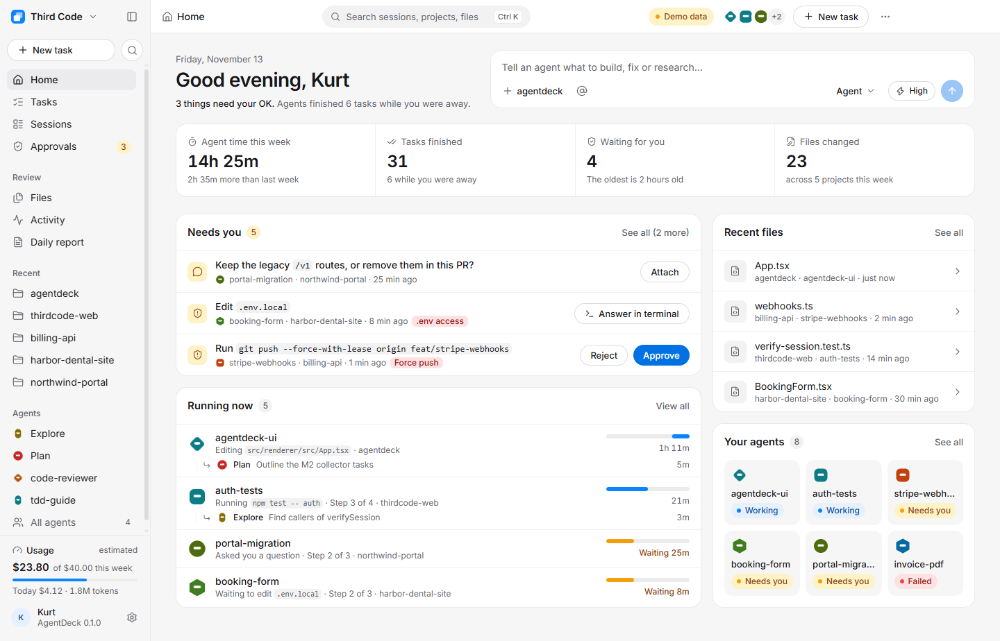
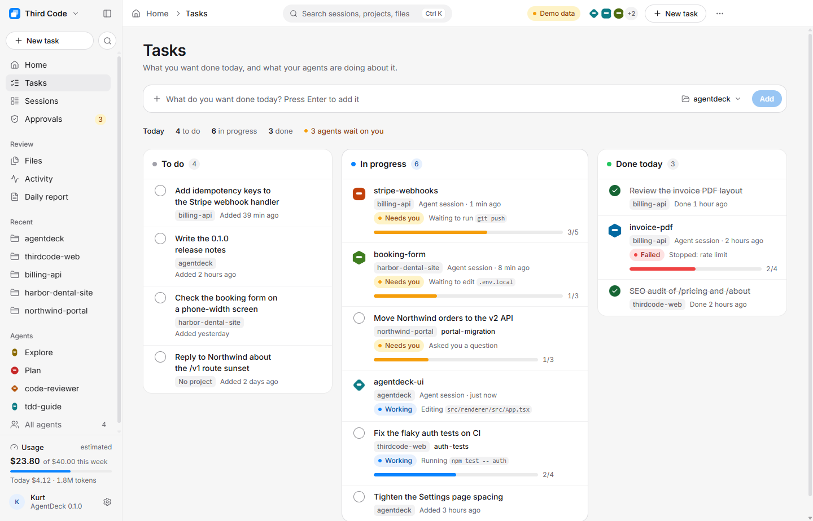
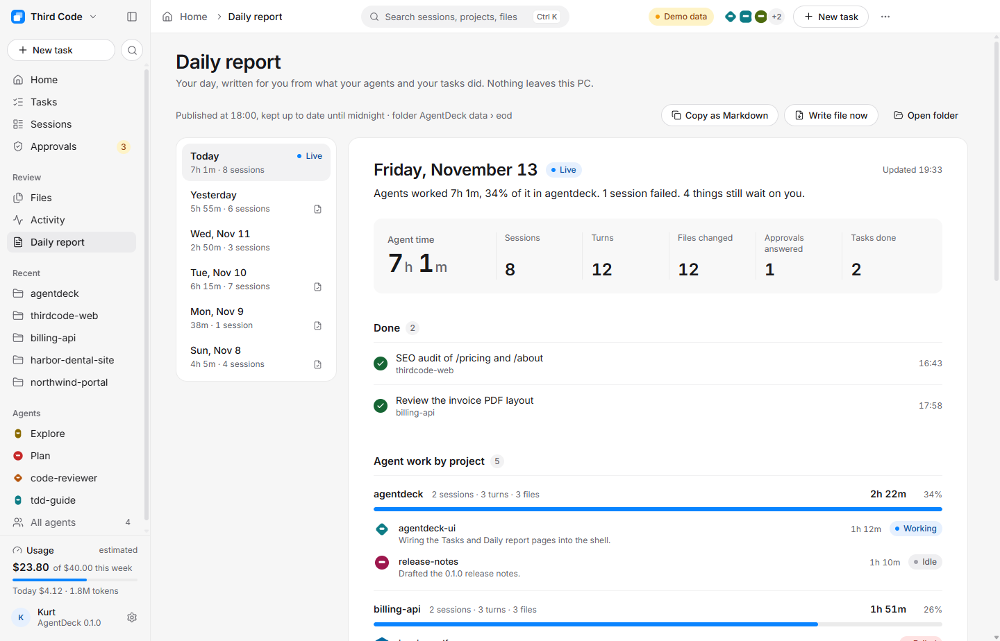
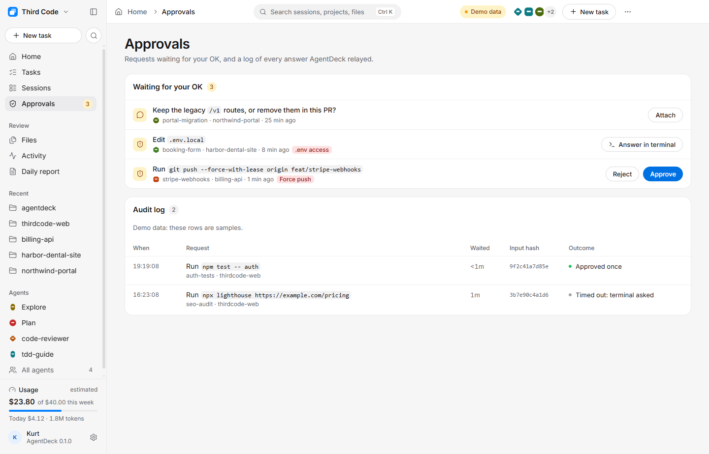
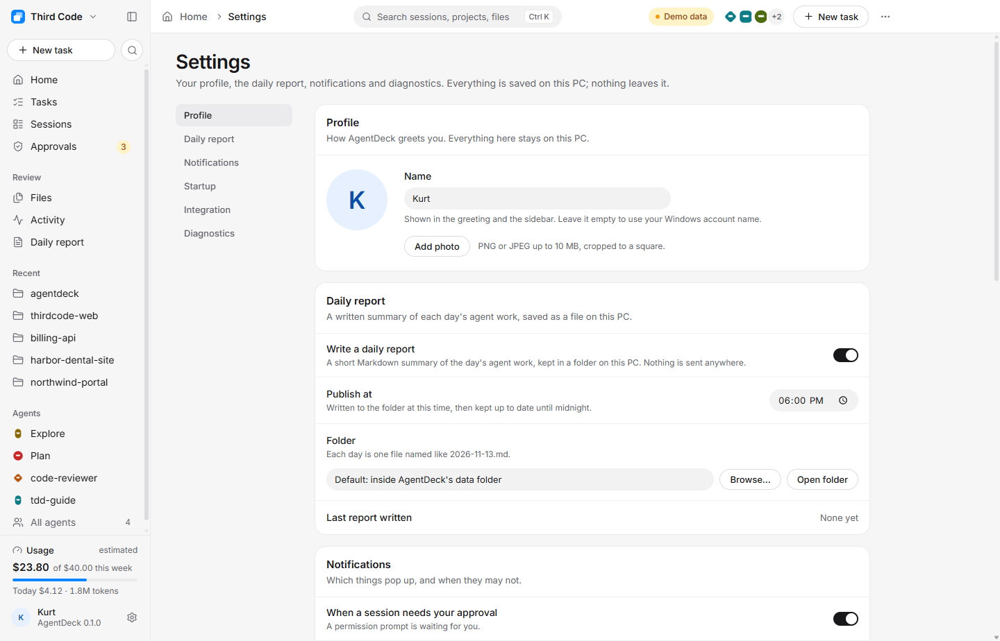
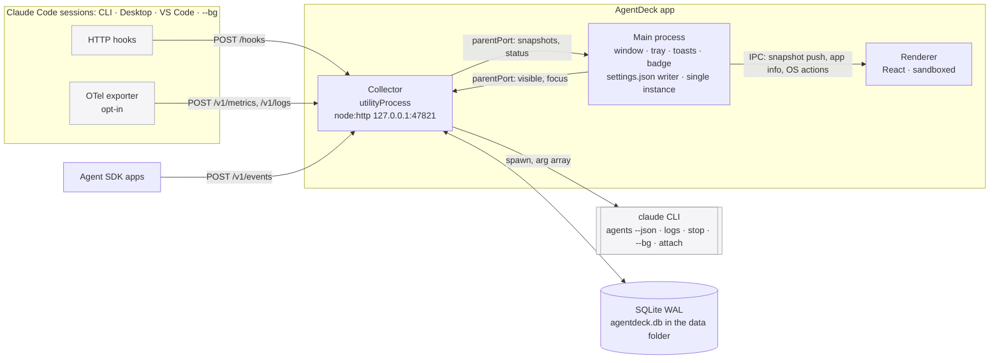

# AgentDeck

**See every Claude Code session on your PC, and the one that needs you.**

AgentDeck is a tray app for Windows and macOS (a menu bar app on the Mac). It watches your Claude Code sessions (terminal, Claude Desktop, background) and tells you which one is waiting for an approval, an answer or a look. It observes sessions and relays your explicit decisions. It never approves anything by itself, makes no model calls of its own, and sends nothing off your machine.

[](https://github.com/kurtgav/Agent-Desk/actions/workflows/ci.yml)
[](https://github.com/kurtgav/Agent-Desk/releases)
[](LICENSE)




## Why

Once you run Claude Code for real work, you end up with several sessions at once: a terminal tab, one in Claude Desktop, a background run you started with `--bg`, a few subagents inside each. One of them stops to ask permission to run a command. Nothing tells you which one, so it sits there for an hour while you look at the wrong window.

AgentDeck puts all of them in one place, sorts what needs you to the top, and sends a notification when something does.

## Features

- **Needs-you queue.** One list with four priorities. P1: a permission request or a question for you. P2: a failed turn or a rate limit. P3: a session that looks stuck (no events for 5 minutes, or one tool running over 10; both configurable). P4: a finished turn ready for review.
- **Live sessions and subagents.** Every session that `claude agents` lists (CLI, Claude Desktop, background), with what it is doing right now and which subagent is running under it.
- **Remote approvals (opt-in).** Approve or Reject a permission request from AgentDeck instead of hunting for its terminal. Approve-once only, a confirm step that shows the full command for risky ones, and an audit log of every answer.
- **Composer.** Type a task, pick a project, optionally a subagent and an effort level, and AgentDeck starts a background session (`claude --bg`) for it.
- **Console.** Talk to Claude Code from AgentDeck, like Claude Desktop or the CLI: start a conversation in a project, watch the answer stream in, follow each tool call, answer, follow up, stop a turn, or resume a session. It runs your own signed-in Claude Code, so it uses your own subscription; the text stays in memory and is never written to disk. Not in v1: slash commands, MCP and plugin management, image attachments. The first reply of a conversation costs the most, because Claude Code loads your agents, skills and MCP setup.
- **Roles.** Pick who a conversation or task works as: a CTO, a Founding Engineer, a Frontend Developer, an SEO Specialist, about 300 in all. Browse by division, search by name, by title ("cto") or by describing the task ("our postgres queries are slow"), pin favourites, and write your own. The roles come from files on your PC: the open-source [agency-agents](https://github.com/msitarzewski/agency-agents) library (read from your own clone, never downloaded by AgentDeck), the agents you installed in Claude Code, your own, and seven leadership roles that ship with the app. No model is used to search or suggest.
- **Usage, if you want it.** Turn on Claude Code's own telemetry from Settings (you see the exact diff first) and the Usage card shows tokens and an API-equivalent cost estimate against a weekly budget you set. AgentDeck cannot see your plan's own 5-hour or weekly limits; Claude Code's `/usage` does.
- **Tasks.** Your own to-dos next to the live agent work, on one board with four lanes: To do, In progress (what is running), Waiting on you (approvals, questions, failed and stuck runs, the most urgent on top, each card saying why) and Done today. One line above it counts all four and how many agents are running. Send a to-do to an agent as a background session and its live status appears on the card; answer or dismiss what waits on you and the card moves on by itself.
- **Daily report.** A markdown file per day (`YYYY-MM-DD.md`), written without you asking: published at a time you choose (18:00 by default), then kept up to date until midnight so late work is not lost. It holds the time agents worked, sessions, files changed, approvals answered, tasks done, what still waits on you, and tomorrow's open tasks, plus your own notes. The same report is a page in the app, with Copy as Markdown. Built from data AgentDeck already has: no model writes it.
- **Tray, badge, toasts.** The tray (menu bar on macOS) dot shows status. The taskbar badge, or the Dock badge on macOS, counts open P1 and P2 items. Toasts fire for P1, P2 and completions, are suppressed when the window is already in front, and support quiet hours and a pause. Toasts are the system's own notifications, and Settings has a "Send a test notification" button.
- **Light and dark.** One click in the top bar flips the theme; "Use system settings" follows your computer's setting. Every agent gets its own mascot picture, the same one every time.
- **Files changed.** The files Claude's edit tools changed, grouped by project, opened in VS Code with a click.

| | |
|---|---|
|  |  |
|  |  |

## Roles

The **Roles** page (sidebar, or Ctrl+K and type a title) is a catalog of personas for Claude Code. A role is a Markdown file with a name, a one-liner and the text Claude Code works from, the same format Claude Code's own agents use.

- **Where they come from.** `~/.claude/repos/agency-agents` (or the folder you point at, or `CLAUDE_CONFIG_DIR/repos/agency-agents`), `~/.claude/agents`, a roles folder in AgentDeck's data folder, and the leadership roles in the app. If the library is not on your PC, the page shows the one `git clone` command and a field to point at a copy you already have. To update it, run `git pull` in that folder and choose Reload: AgentDeck itself never fetches anything.
- **Installed or not.** A role that is installed in Claude Code runs as `claude --agent <name>`. One that is not is handed to Claude Code as text for that conversation; nothing is added to your agents folder.
- **A skill file per role, when you want one.** Any role can be added as a Claude Code skill: **Add as a skill** in its panel, or **Add N as skills** for the roles shown in a division. AgentDeck writes `~/.claude/skills/agency-<role>/SKILL.md` (the agency-agents `skill-md` layout: name, description, the role's full text), so Claude Code can pick the role up by itself when a task fits. Nothing is added unless you click, because every skill adds its description to every Claude Code session. AgentDeck marks the files it writes and only ever replaces or removes those; a skill you made under the same name is left alone.
- **Your own roles.** Create one in the app, or duplicate any role and edit the copy. They are plain files in `<AgentDeck data folder>\roles`, so you can edit them by hand.
- **Credit.** The library is [msitarzewski/agency-agents](https://github.com/msitarzewski/agency-agents) (MIT). It is read from your own clone and is not bundled; see THIRD_PARTY_NOTICES.md.

## Privacy and safety guarantees

Each line below is a documented design rule. The linked doc says how it is enforced or checked.

- **Loopback only.** Everything AgentDeck listens on is bound to `127.0.0.1`. A request must carry the exact `Host`, no `Origin` header (so a web page in your browser cannot reach it), and a per-install 256-bit token. ([ADR-0010](docs/adr/0010-security-model.md), [Architecture § 8](docs/ARCHITECTURE.md))
- **No model calls of its own.** Summaries and the "asked you a question" flag come from fixed rules, not an LLM. When you start a task or a conversation from AgentDeck, your own signed-in Claude Code does the work, exactly as if you had typed it in a terminal; AgentDeck never calls a model or Anthropic itself. ([ADR-0009](docs/adr/0009-supported-interfaces-only.md), [State machine § 4](docs/STATE_MACHINE.md))
- **No network.** No listener except loopback and no outbound request. Fonts and icons are bundled, and auto-update does not exist in v1. ([ADR-0009](docs/adr/0009-supported-interfaces-only.md))
- **Never auto-approves.** An approval needs a click in the AgentDeck window. There is no API-only path, the answer applies to that one request, and AgentDeck never adds permission rules. ([ADR-0006](docs/adr/0006-remote-approvals.md))
- **Never reads transcript content.** It reads hook payloads, the output of `claude agents --json --all`, and `claude logs`. It never opens `~/.claude/jobs`, `~/.claude.json` or credentials, and it drops `transcript_path` at ingest. There is one opt-in switch, off by default, that reads only token counts (a time, a model, four numbers and two ids per message) from Claude Code's local session logs, so usage shows for sessions that are already open. It never reads a prompt, a reply, a tool's input or output, or a file's contents. ([ADR-0009 and its Amendment](docs/adr/0009-supported-interfaces-only.md))
- **Redaction before storage.** Keys, tokens, passwords, private keys and common vendor key formats are masked before an event is stored or shown, and file bodies are never stored. The rules are pattern-based, so a secret in a shape no rule knows can slip through ([R32](docs/RISKS.md)). Everything stays in AgentDeck's data folder (see [Configuration](#configuration)). ([Event schema § Redaction](docs/EVENT_SCHEMA.md))
- **Your `settings.json` stays yours.** Hooks are added only after you read a diff and accept it. Every write is backed up first (last 20 kept) and is a text edit that touches only AgentDeck's own entries. Quitting AgentDeck removes them, and uninstalling runs the same removal. ([ADR-0005](docs/adr/0005-hook-install-lifecycle.md), [ADR-0012](docs/adr/0012-packaging.md))
- **Honest limits.** If AgentDeck itself crashes, its hook entries stay until the next launch. They cost each hook event 4 to 57 ms and print one stderr line in `claude -p` runs until then ([R2](docs/RISKS.md), [spike S2](docs/SPIKES.md)). Another process running as you can read the token from `config.json` in AgentDeck's data folder. That is an accepted part of the threat model, since such a process could already edit `settings.json`.

Report a vulnerability through [SECURITY.md](SECURITY.md).

## Install

Windows 11, or macOS (Apple silicon and Intel).

### Windows

1. Download `AgentDeck-Setup-<version>.exe` from the [latest release](https://github.com/kurtgav/Agent-Desk/releases/latest).
2. Run it. It installs for your user only, needs no admin rights, and puts AgentDeck in `%LOCALAPPDATA%\Programs\AgentDeck` with a Start menu entry and a desktop shortcut.

**SmartScreen will warn you.** The v1 installer is not code-signed: a signing certificate costs money every year and AgentDeck is free, open source and run by one person. Windows therefore shows "Windows protected your PC". Click **More info**, then **Run anyway**, if you are comfortable with that. You do not have to take the binary on trust:

- **Check the download.** The release lists a SHA-256 for the installer in `SHA256SUMS.txt`. Compare it with your file:

  ```powershell
  (Get-FileHash .\AgentDeck-Setup-0.1.0.exe -Algorithm SHA256).Hash
  ```

  A match shows your file is the one attached to the release. It does not prove who built it.
- **Or build it yourself** from the tagged source (see [Build from source](#build-from-source)).

To uninstall, use Windows Settings, Apps. AgentDeck's data in `%APPDATA%\AgentDeck` is kept; delete the folder if you want it gone.

### macOS

1. Download `AgentDeck-<version>-arm64.dmg` (Apple silicon) or `AgentDeck-<version>-x64.dmg` (Intel) from the [latest release](https://github.com/kurtgav/Agent-Desk/releases/latest).
2. Open it and drag AgentDeck to Applications.

**macOS will refuse it the first time.** The app is not signed with an Apple Developer ID or notarized, for the same reason the Windows installer is unsigned. Control-click AgentDeck in Applications and choose **Open**, then **Open** again. On macOS 15 and later, open it once, then go to System Settings > Privacy & Security and click **Open Anyway**. Or clear the quarantine flag yourself:

```sh
xattr -dr com.apple.quarantine /Applications/AgentDeck.app
```

Check the download the same way, against `SHA256SUMS.txt`: `shasum -a 256 AgentDeck-0.1.0-arm64.dmg`.

The first time AgentDeck opens Terminal or iTerm for you (Attach, Terminal here), macOS asks whether AgentDeck may control it. Allow it, or change it later in System Settings > Privacy & Security > Automation.

To uninstall, quit AgentDeck (that removes its hook entries from `settings.json`) and move it to the Bin. If it had crashed, remove the entries first with `/Applications/AgentDeck.app/Contents/MacOS/AgentDeck --uninstall-integration`. Its data in `~/Library/Application Support/AgentDeck` is kept; delete the folder if you want it gone.

## Quick start

1. Start AgentDeck. It opens a window and stays in the tray when you close it. To look around first, open the **Third Code** menu (top left) and turn on **Demo data**: sample sessions, nothing real is touched.
2. With Demo data off, Home shows a red **Hooks missing** chip. Click it. The dialog shows what would change in `~/.claude/settings.json` (structure only, values hidden). Nothing is written until you accept.
3. Start or keep using Claude Code as usual. Sessions appear under **Running now**, and anything that needs you shows in **Needs you** and as a toast.
4. Optional: in the **⋯** menu, turn on **Remote approvals** if you want Approve and Reject buttons. While AgentDeck waits for your click (60 seconds by default), the terminal's own prompt is deferred. If you do not click, the terminal asks as usual.

It needs Claude Code on your `PATH` (or in `~/.local/bin`, where its native installer puts it). On macOS, AgentDeck reads `PATH` from your login shell, so Homebrew and nvm installs are found even though apps started from the Dock get a bare one. It has been tested with Claude Code 2.1.317 and 2.1.318; what each version was checked for is in [COMPATIBILITY.md](docs/COMPATIBILITY.md).

## How it works



Claude Code's HTTP hooks post each event to the collector on `127.0.0.1`. The collector replies at once, then stores and reduces the event. A poll of `claude agents --json --all` finds sessions that hooks do not cover and fills in background state. The UI reads snapshots through the main process and never holds the token. On a real `claude -p` run the time from hook to screen was 113 ms at the median and 129 ms at p95, mostly a deliberate 100 ms throttle. Details: [ARCHITECTURE.md](docs/ARCHITECTURE.md).

## Build from source

You need Windows 11 or macOS, Node 24, and Claude Code on your `PATH`.

```powershell
git clone https://github.com/kurtgav/Agent-Desk.git
cd Agent-Desk
npm ci
npm run dev        # live mode; the Third Code menu has a "Demo data" toggle
```

| Command | What it does |
|---|---|
| `npm run check` | typecheck, lint, Vitest unit and integration tests, Playwright-Electron smoke tests |
| `npm run pack` | builds an unpacked app into `release/` (quick packaging check) |
| `npm run dist` | builds the NSIS installer into `release/` (on Windows) |
| `npm run dist:mac` | builds the dmg and zip, arm64 and x64, into `release/` (on a Mac) |

The release folder is git-ignored. `npm run dist` downloads electron-builder's Windows tooling on first use. The Playwright smoke tests run on Windows only.

## Configuration

AgentDeck keeps its files in `%APPDATA%\AgentDeck` on Windows and `~/Library/Application Support/AgentDeck` on macOS:

| File | Holds |
|---|---|
| `agentdeck.db` | sessions, events, changed files and the approvals audit log (events and sessions are pruned after 30 days by default) |
| `config.json` | the hook token, the bound port, notification and approval settings |
| `logs\` | rotating logs (5 files of 5 MB) |
| `backups\` | copies of `settings.json` taken before each write (last 20) |

Most settings live on the Settings page. AgentDeck reads Claude Code's config from `CLAUDE_CONFIG_DIR`, or `~/.claude` when it is unset. The default port is 47821; if it is taken, AgentDeck uses the next free one in 47822 to 47831 and rewrites its hook entries to match.

## FAQ

**Does it cost anything?** No. AgentDeck is MIT-licensed and needs no account, server or API key. The only paid part is Claude Code itself, which you already use.

**Does it send data anywhere?** AgentDeck makes no outbound requests and makes no model calls of its own. Claude Code still talks to Anthropic as it always did; AgentDeck sits beside it on your machine. See [Privacy and safety guarantees](#privacy-and-safety-guarantees).

**Does it work with Claude Desktop and VS Code?** Claude Desktop sessions are listed and shown live. Whether Desktop's bundled Claude Code runs the user-level hooks is the least tested part ([R8](docs/RISKS.md)). The VS Code extension is detected from the process path but has not been verified against a real VS Code session yet ([R9](docs/RISKS.md)).

**Do I see approvals if I run `--dangerously-skip-permissions`?** Few. That mode skips the permission prompts, so there is little to approve. Failures, finished turns, stuck sessions and the daily report still work.

**macOS or Linux?** macOS, yes: a dmg for Apple silicon and Intel, checked by CI on a macOS runner. Linux is not built or tested, and I am not promising a date. On the Mac, "Answer in terminal" brings the terminal app forward rather than the exact tab, and the keyboard shortcuts take Cmd as well as Ctrl, though their hints still say Ctrl.

**What if AgentDeck crashes?** Claude Code is unaffected. The collector runs in its own process, and the main process restarts it if it dies. If the whole app dies, its hook entries stay in `settings.json` until the next launch (see the honest limits above), and held approvals fall back to the terminal prompt.

**Why do some sessions show up late or not at all?** In an interactive session, Claude Code holds back hooks in a folder you have not trusted yet. AgentDeck still sees that session through the poll, but with less detail ([R4](docs/RISKS.md)).

## Roadmap

Not in v1, and not promised: a Linux build, a code-signed installer and a notarized Mac app (and with them a quieter SmartScreen and Gatekeeper), and automatic updates. Open verification work: VS Code sessions, Claude Desktop hooks, and what the terminal prompt does exactly while AgentDeck holds an approval in an interactive session ([R34](docs/RISKS.md)). The risk register in [docs/RISKS.md](docs/RISKS.md) is the honest to-do list.

## Contributing

Issues and pull requests are welcome. Start with [CONTRIBUTING.md](CONTRIBUTING.md): it covers setup, the checks, how decisions are recorded, and the three rules a change must not break (no network, no model calls, never auto-approve). Please follow the [Code of Conduct](CODE_OF_CONDUCT.md). Questions go to [SUPPORT.md](SUPPORT.md).

## Docs

[Architecture](docs/ARCHITECTURE.md) · [ADRs](docs/adr) · [Event schema](docs/EVENT_SCHEMA.md) · [State machine](docs/STATE_MACHINE.md) · [UI map](docs/UI_MAP.md) · [Compatibility](docs/COMPATIBILITY.md) · [Decisions](docs/DECISIONS.md) · [Risks](docs/RISKS.md) · [Spikes](docs/SPIKES.md)

## License

[MIT](LICENSE) © 2026 Kurt Gavin. Built by Third Code.

The bot mascot is "helper-robot" from [IP as Logo](https://visualskills.dev/ip-as-logo), whose README says every logo there is free for commercial use ([source](https://github.com/s1dashu/ip-as-logo-skill)). The agent avatars (a mascot per agent name, in `src/renderer/src/assets/agents`) are more logos from the same gallery under that same sentence, and so are the role mascots (one per role, chosen to fit what the role does, in `src/renderer/src/assets/roles`). See [THIRD_PARTY_NOTICES.md](THIRD_PARTY_NOTICES.md).
