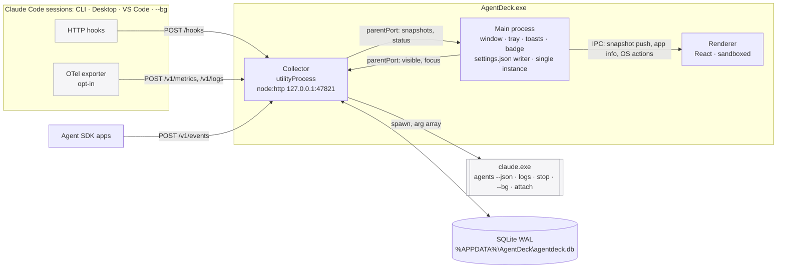

# AgentDeck architecture

AgentDeck is a local Windows tray app. It shows what every Claude Code session on this PC is doing and tells you when you need to step in.

It **observes** sessions and **relays your explicit decisions**. It never auto-approves, never blocks anything on its own, sends nothing off the machine, and makes no LLM calls. Every integration point and its doc citation is in `COMPATIBILITY.md`; spike evidence is in `SPIKES.md`; one-off defaults are in `DECISIONS.md`.

## 1. Processes

| Process | Owns | Never does |
|---|---|---|
| **Main** | BrowserWindow, tray, `setOverlayIcon` badge, `flashFrame`, toasts (AUMID), login item, single-instance lock, `powerMonitor`. It is the **only writer of `~/.claude/settings.json`** (install, repair, uninstall, launch/quit lifecycle). Restarts the collector if it crashes. | Parse hook traffic |
| **Collector** (`utilityProcess`) | `node:http` on 127.0.0.1: hook ingest, OTLP receiver, Reporter API. Also the agents poller, reducers, the attention engine, SQLite, every `claude` / `code` spawn (cross-spawn, argument arrays, scrubbed env per ADR-0008), and the snapshot it posts to main for the UI (D-040). | Touch settings files or the window |
| **Renderer** | UI only: `contextIsolation`, `sandbox`, no Node, strict CSP. It gets snapshots from main through preload and holds no port or token. | Talk to the collector or the network |

## 2. Hook ingest path (budget: p95 < 20 ms from request to response, measured collector-side)

1. `POST /hooks`. The collector checks the `Host` header is `127.0.0.1:<port>`, rejects any request that carries an `Origin` header, and requires `X-AgentDeck-Token` (compared in constant time).
2. **It replies `200` with an empty body at once.** Spike S3 showed a slow reply costs the session up to `timeout` per event. The one exception is `PermissionRequest` while remote approvals are on (ADR-0006).
3. The body is pushed onto an in-memory queue. `setImmediate` drains it: zod-parse (unknown fields are tolerated and kept), normalize to `AgentEvent` (EVENT_SCHEMA), redact, insert in a single transaction per batch, and run the reducers (Session, Agent, inflight tools, files, attention).
4. After a change the collector posts the whole Home snapshot to main, at most every 100 ms (plus a 30 s heartbeat). Main caches it and pushes it to the renderer over IPC (D-040; the renderer can't call the collector without sending an `Origin`). Budget: **event to screen p95 < 1 s**, with a target of < 100 ms. Measured on a real `claude -p` run: p50 113 ms, p95 129 ms, mostly the throttle.

## 3. Reconcile path: `claude agents --json --all` (ADR-0004)

- **Cadence:** 3 s while the window is visible, 15 s while hidden. It drops to 1 s for up to 2 min while a P1 item is open. A refresh is also debounced to 300 ms after hook events.
- One poll runs at a time, and a poll is skipped if the last one ended less than 1 s ago.
- The poller diffs each row against the last snapshot, keyed by `sessionId`, with `id` as the fallback for background rows. Each change becomes a `session.state` event, and rows that vanish become `session.gone` events.
- The poll **discovers sessions**, because HTTP hooks don't run on `SessionStart` (F3). It also supplies the background `state` and `waitingFor`, and covers folders where hooks are held back until the workspace is trusted.
- If the output is not a JSON array, or agent view is disabled, the poller backs off to 60 s and Diagnostics shows "Session registry unavailable". Hooks keep working on their own.
- Surface detection (CLI / Desktop / VS Code) uses the exe path of each new `pid` (D-021). It is looked up once per pid and cached.

## 4. Storage (ADR-0003)
SQLite via `node:sqlite` in the collector (D-042), with WAL, `synchronous=NORMAL`, and a single connection. M2 ships `events`, `sessions`, `work_spans`, `finished_turns` and `files` (ADR-0003 M2 amendment); the other tables below arrive with the features that fill them.

| Table | Purpose |
|---|---|
| `events` | append-only `AgentEvent`, indexed on `(session_id, ts)`, `(tool_use_id)`, `(kind, ts)` |
| `sessions` | derived: surface, cwd, name, status, lastEventAt, model, counters |
| `agents` | subagents: `agent_id`, `agent_type`, parent, task text, status |
| `attention_items` | the attention engine's output: priority, type, state, resolvedBy |
| `approvals` | audit log of every remote decision (who, when, what, outcome). Kept for 1 year, not 30 days |
| `files` | file changes from edit tools: path, session, ts, tool |
| `usage` | OTel delta points aggregated per day × session × model × type |
| `kv` | settings, UI state, last-known snapshot |

- Retention defaults to 30 days and is configurable. A daily prune also runs at launch.
- The UI first paints from `sessions`, `attention_items` and `kv`, then streams live updates.

## 5. Collector API (loopback only, token required)
| Route | Use |
|---|---|
| `POST /hooks` | Claude Code HTTP hooks |
| `POST /v1/metrics`, `POST /v1/logs` | OTLP/HTTP JSON (accepts `application/json`; protobuf answers 415) |
| `POST /v1/events` | Reporter API (same `AgentEvent` schema, `source:"reporter"`) |
| `GET /api/snapshot` | everything the Home screen needs |
| `GET /api/sessions/:id`, `/api/sessions/:id/events`, `/api/sessions/:id/logs` | session drawer |
| `POST /api/attention/:id/{approve,reject,dismiss}`, `POST /api/sessions/:id/{stop,attach,open}`, `POST /api/dispatch` | actions |
| ~~`GET /api/stream`~~ | dropped in M2: the UI gets snapshots through main (D-040) |
| `GET /health` | port-conflict probe: returns `{app:"agentdeck", pid}` only when the token matches |

## 6. Hook integration lifecycle (ADR-0005)
1. **Consent:** "Install integration" (M3) shows a diff, writes a backup, and records your OK.
2. **Launch:** main merges our entries into `settings.json`. Running sessions pick them up through the settings watcher.
3. **Quit:** main answers any held approvals with an empty response, then removes our entries.
4. **Crash:** the entries stay until the next launch. Leftover entries cost each hook event 4–57 ms and print one stderr line in `-p` runs (spike S2), until launch reconciles them.

Our entries are identified by `type:"http"`, a URL matching `^http://127\.0\.0\.1:\d+/hooks$`, and an `X-AgentDeck-Token` header (D-022). Entries we did not create are never touched. Uninstall removes only our entries.

## 7. Desktop behaviour
- Single-instance lock; a second launch focuses the existing window.
- `setLoginItemSettings({openAtLogin:true})`.
- Window bounds are saved and restored. Minimum size is 1200×760.
- Closing the window hides it to the tray, with a one-time hint. Quit is only in the tray menu.
- The taskbar overlay badge shows the count of open P1+P2 items. The tray dot shows status: green = live, amber = needs you, gray = paused, red = hooks missing.
- `flashFrame` fires on a new P1 while the window is unfocused.
- Toasts fire for P1, P2 and completions. A toast is suppressed if that item is already on screen, and quiet hours apply.
- Custom title bar via `titleBarOverlay`.
- On `powerMonitor` `resume` or `unlock`: force a poll, mark sessions stale until confirmed, and re-check that the port is still bound.

## 8. Security model (ADR-0010)
- Everything binds to 127.0.0.1. The `Host` header is checked to block DNS rebinding, and requests with an `Origin` header are rejected.
- A per-install 256-bit token protects every route.
- The token is stored in `%APPDATA%\AgentDeck\config.json` and in our hook headers. The threat model accepts that other local processes running as the same user can read it.
- Remote approvals need the token **and** a click in the AgentDeck window. There is no API-only approve.
- Payload previews are redacted (EVENT_SCHEMA § Redaction). OTel identity attributes are dropped at ingest.
- AgentDeck never reads transcripts, `~/.claude/jobs`, credentials or `~/.claude.json` (ADR-0009).
- Logs rotate in `%APPDATA%\AgentDeck\logs` (5 × 5 MB).

## 9. Performance budgets and how each is measured
| Budget | Measured by |
|---|---|
| Hook ingest p95 < 20 ms | collector histogram (`/health?metrics`) + an autocannon run in CI |
| Event to screen p95 < 1 s | `tests/live.spec.ts` fails if a posted PreToolUse is not on screen within 1 s; real runs compare each pushed snapshot's newest `lastEventAt` with `Date.now()` in the next animation frame |
| Idle CPU < 1 % (whole machine, AgentDeck process tree **including spawned `claude agents`**) | perf counters over 10 min with the window hidden (expect about 0.2 % from the poll alone) |
| RAM < 300 MB | working set of main + collector + renderer |

## 10. Paths
`%APPDATA%\AgentDeck\` holds `agentdeck.db`, `config.json`, `logs\` and `backups\` (copies of settings.json, last 20). There is also a separate `demo.db` for Demo mode (ADR-0011).

The Claude config dir is `CLAUDE_CONFIG_DIR`, or `%USERPROFILE%\.claude` when that is unset.

## 11. Out of scope (v1)
claude.ai and cloud sessions, WSL, macOS and Linux builds (the code stays portable: no Windows-only APIs outside `main/os/*`), remote or multi-user access, and auto-approve rules.
