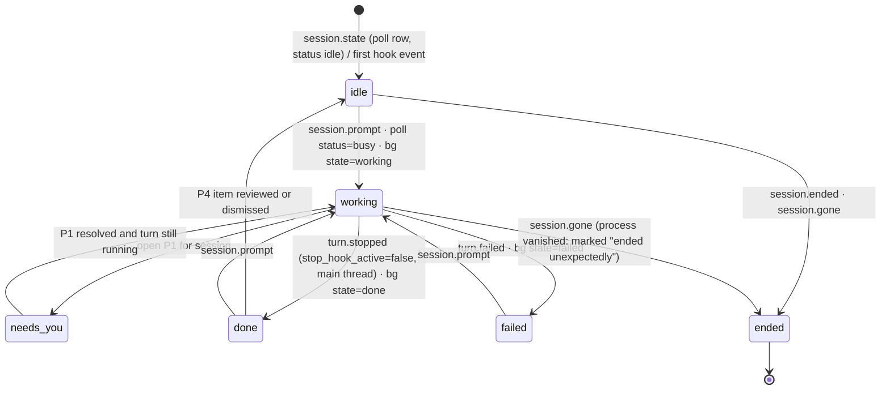
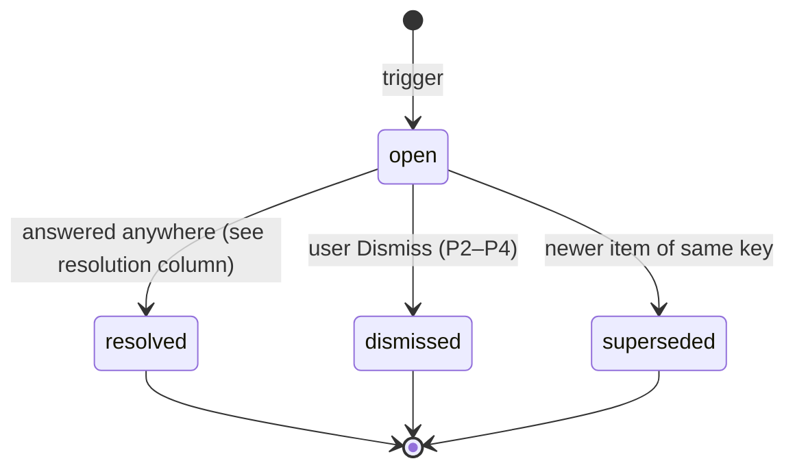

# State machines and the attention model

Every machine here is a pure reducer of the form `(state, AgentEvent, now) → state`. Each one is fully unit-tested (§ 6). Time-based rules (stall, expiry) run through a 1 s `tick` event, so tests can drive time deterministically.

## 1. Session

- **Pill mapping:** working → **Working** (blue), needs_you → **Needs you** (amber), failed → **Failed** (red), idle and ended → **Idle** (gray), done → **Done** (green).
- **Rule order:**
  1. An open P1 item makes the pill Needs you, whatever else is true.
  2. The latest turn outcome comes next.
  3. Otherwise the poll status decides.
- **Hooks vs poll:** hook events win over the poll for ~5 s after they arrive, so a lagging poll cannot flip the state back. A poll held back this way is kept and applied once the window has passed (D-058): the Poller reports only rows that change, so an Esc mid-turn (no Stop hook) seen inside the window would otherwise never be applied. The poll wins for sessions with no hook traffic, such as untrusted folders (labelled "Hooks blocked: folder not trusted") or hooks paused.
- **Restart (D-057):** a session that was `working` when AgentDeck stopped has its stretch closed at its last event and shows `idle` until a hook or the poll says otherwise; nobody saw what it did meanwhile. The first poll after a restart ends every stored live session it does not list. A vanished row does not move `lastEventAt`: the session ended at some point since its last event, not when we noticed.
- **Stale:** after sleep/resume, or a gap of more than 3 polls, sessions are marked `stale` (pill shows "Checking…") until the next poll confirms them.
- **Subagents** do not change the session's pill. They have their own rows.

## 2. Agent (subagent) and tools in flight
- `subagent.started` creates an agent `{agentId, agentType, parent: main, task: Agent tool_input.description}` with status running. `subagent.stopped` sets it to finished. A `session.ended` or `session.gone` while it is running sets it to orphaned.
- **Inflight tools:** `tool.started` adds `inflight[toolUseId]` and `tool.finished` / `tool.failed` remove it.
  - `turn.stopped` clears that agent's inflight set, because denied tools never get a Post event (spike S4). `session.ended` clears the whole session.
  - Tools that return immediately do not count as in flight beyond their Post event: the Agent tool with `async_launched`, and Bash with `run_in_background:true`.
- **Plan progress ("Step 2 of 4"):** count `task.created` and `task.completed` per session. The progress bar is determinate only while at least 1 task exists; otherwise it is indeterminate.

## 3. AttentionItem

- **Item key** (at most one open item per key):
  - P1 approval: `(sessionId, agentId, toolUseId)`
  - P1 answer: `(sessionId, agentId, 'answer')`
  - P2: `(sessionId, 'failed')`
  - P3: `(sessionId, agentId, 'stuck')`
  - P4: `(sessionId, 'review')`
- **Sort order** for "Needs you": priority, then `openedAt` (oldest first).
- **Resolution target:** ≤ 2 s after the item is answered anywhere.

| Priority / type | Triggers | Shows | Resolves when |
|---|---|---|---|
| **P1 Needs approval** | `permission.requested`; poll `waitingFor` = `permission prompt` or `sandbox request` (poll-only when there is no hook); `notification` type `permission_prompt` (enriches an existing item, never duplicates it) | exact tool, command or file path, risk flags (§ 5), agent, cwd, age | `permission.decided`; `tool.finished` / `tool.failed` of its `toolUseId`; any later event of the same agent except `notification`; poll `waitingFor` no longer `permission prompt` (bg) or `status` ≠ `waiting` (interactive); `session.ended` / `session.gone` |
| **P1 Needs your answer** | `tool.started` of `AskUserQuestion` (shows the questions); `notification` type `elicitation_dialog`, `elicitation_url_dialog`, `agent_needs_input`; poll `state=blocked` with `waitingFor` = `input needed`, `dialog open` or `worker request`; `tool.started` of `ExitPlanMode` (shown as "Plan ready to approve") | the question or plan text | that tool's Post or Failure; next `session.prompt`; poll status leaves `waiting`; session ended |
| **P2 Failed / limited** | `turn.failed` (`error` value); poll `state=failed`; `notification` type `quota_auto_resume_*`; OTel `api_error` only when it repeats (≥ 3 in 2 min) | reason and fix hint (§ 4) | next `session.prompt` or `session.state` working; Dismiss |
| **P3 Possibly stuck** | session working, no events for **N = 5 min**, nothing in flight; **or** one inflight tool running **> M = 10 min** (N and M configurable) | last activity and how long it has run | any next event for that agent; Dismiss (snoozes for 2N) |
| **P4 Ready for review** | `turn.stopped` (main thread, `stop_hook_active=false`); bg `state=done`; `notification` type `idle_prompt` or `agent_completed` | `last_assistant_message` (first 400 chars); flag "asked you a question" (§ 4) | next `session.prompt`; Open or Dismiss; drawer viewed for ≥ 2 s |

- **Remote approvals:** Approve/Reject appear only on P1 approval items that are **held**, meaning remote approvals are on and the hook request is still pending. Every other item offers Attach, Open in Desktop, Answer in terminal, or Dismiss (UI_MAP).
- **Fast poll:** while any P1 is open, the poller runs at 1 s for up to 2 min per item. A long approved tool sends its Post event only when it completes, so the poll's status flip is the earliest signal (ADR-0004, risk R5).

## 4. Text heuristics (deterministic, no LLM)
- **"Asked you a question":** the last non-empty line of `last_assistant_message`, after markdown is stripped, ends with `?`. Or the message contains `Do you want`, `Should I`, `Would you like`, `Which` … `?` within its last 3 lines.
- **StopFailure fix hints:**

| `error` | hint |
|---|---|
| rate_limit | "Rate limited. It resumes when your limit resets; run `/usage` in the session." |
| overloaded, server_error | "Anthropic API busy. Retry the turn." |
| authentication_failed, oauth_org_not_allowed | "Sign in again: run `claude auth login`." |
| billing_error, account_on_hold | "Check your plan and billing at claude.ai settings." |
| model_not_found | "Model unavailable. Pick another with `/model`." |
| max_output_tokens | "Response hit the output limit. Ask it to continue." |
| invalid_request, unknown, cloud_credential_error | show `error_details` verbatim |

## 5. Risk flags (display only; they never block anything)
Checked against Bash/PowerShell `tool_input.command`, file-tool `file_path` and `notebook_path`, and WebFetch URLs. Matching is case-insensitive.

| Flag | Pattern |
|---|---|
| Recursive delete | `\brm\s+-[a-z]*r[a-z]*f\|\brm\s+-[a-z]*f[a-z]*r\|Remove-Item\b[^\n]*-Recurse\|\brd\s+/s\|\brmdir\s+/s` |
| Force push | `git\s+push\b[^\n]*(--force\b\|--force-with-lease\|\s-f\b)` |
| Hard reset | `git\s+reset\b[^\n]*--hard` |
| Destructive SQL | `\b(DROP\s+(TABLE\|DATABASE\|SCHEMA)\|TRUNCATE\s+TABLE\|TRUNCATE\b)` |
| DB reset/push | `prisma\s+migrate\s+reset\|supabase\s+db\s+(reset\|push)` |
| Prod deploy / publish | `vercel\b[^\n]*--prod\|railway\s+up\b\|npm\s+publish\b` |
| Secrets file | path or command touching `(^\|[\\/\s])\.env(\.[\w-]+)?\b` |
| Pipe to shell | `(curl\|wget\|iwr\|Invoke-WebRequest)\b[^\n|]*\|\s*(sh\|bash\|zsh\|iex\|Invoke-Expression)\b` |
| Outside workspace | file tools whose `file_path` is not under the session cwd (case-insensitive, after `path.resolve`) |

## 6. Unit tests required before M2 and M3 are done
Reducers are tested against the fixtures in `test/fixtures/hooks/2.1.318` plus synthetic sequences (`src/collector/reduce.test.ts`, `store.test.ts`, `app.test.ts`). M2 covers 1, 2, 3, 4 (interactive and background), 6 and 7. M3 covers 5, 8 and 9 in `src/collector/attention.test.ts` (and `store.test.ts` for persistence and the stall tick); `tests/live.spec.ts` times 9 end to end through the real collector and window.
1. S1 replay gives: 1 session done; Explore subagent nested and finished; 1 task created and completed; files = `hello.txt`; the synthetic `<task-notification>` prompt is not counted as a turn.
2. S4 sequences: allow (Post with the same id) resolves as approved; deny/empty (`turn.stopped` with no Post) resolves as denied; the inflight set is empty after Stop.
3. PermissionRequest correlation picks the right PreToolUse when two parallel tool calls have the same `tool_name` and different inputs.
4. The poll alone (no hooks) drives idle → working → needs_you (bg `waitingFor`) → stopped.
5. Stall: there are no false positives while a tool is in flight below M, and none during an async subagent launch.
6. Precedence: a lagging poll shows `busy` after `turn.stopped` and must not undo `done` within 5 s.
7. Ordering: duplicate or out-of-order hook deliveries are idempotent (dedupe on the SHA-256 of the raw body within 2 s, D-044, D-056). A byte-identical body after the window is a new event.
8. Risk-flag table: one positive and one negative case per row.
9. Resolution ≤ 2 s: a simulated clock asserts that each resolution path closes the item on the next event or the next poll.
